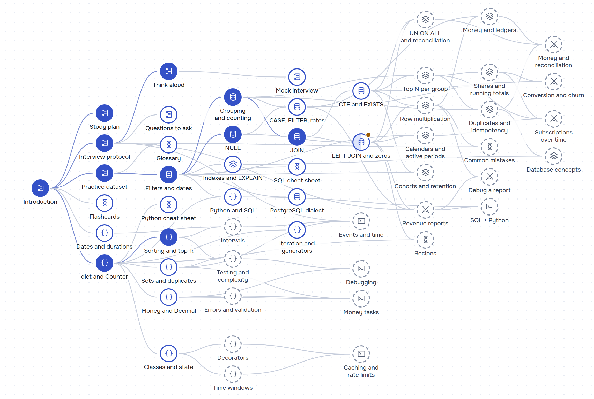

# Live Coding Map

**English** · [Русский](README.ru.md)

Live Coding Map prepares data, analytics and backend engineers for a live-coding round in SQL
and practical Python, and Russian-speaking engineers for interviews in English. Four things set
it apart from a bank of SQL questions. **Interview tasks on one realistic business dataset**,
including work-like Python (idempotency, money, retries, debugging broken code, messy input files, API clients, writing tests), checked by real
tests in your browser. **A protocol for the hour itself**: the questions to ask with the
interviewer's answers, a timer, phrases to think aloud and the follow-up question. **Checks
that catch the traps**: Check also runs your SQL on hidden edge-case data. And it is **free,
with no login, open source, in English and Russian**.

### [Open the site](https://butyavk.github.io/live-coding/) · [Skill map](https://butyavk.github.io/live-coding/start/skill-map/) · [Mock interview](https://butyavk.github.io/live-coding/start/mock-interview/)


<picture>
  <source media="(prefers-color-scheme: dark)" srcset=".github/readme/skill-map-en-dark.png">
  
</picture>

## What is inside

- **57 pages**: seven sections (Start here, SQL foundations, SQL patterns, Python for live
  coding, SQL tasks, Python tasks and Reference) and two About pages.
- **Exercises on every topic page**: 36 SQL drills, 26 Python drills and 23 traps (short
  queries that look right and are not: guess the result, run it, fix it).
- **31 interview tasks**, 15 in SQL and 16 in Python, each with a target time, the questions to
  ask before coding, a timer, a check against the reference, and a walkthrough with the
  follow-up question that usually comes next. Three are debug tasks: working code with bugs and
  a bug report.
- **A mock interview**: a random SQL or Python task from your study plan, with the clock running
  (25 minutes, more for the longest tasks) and nothing on the page that names the technique. You
  type your own questions first; the hint opens after five minutes, the walkthrough and the
  solution when Check passes or the time is up. A checklist for the review comes at the end.
- **Hidden edge-case data** for SQL answers: a day with no activity, a quiet month, sales on
  the last day of a month and exactly at midnight on the 1st, ties, webhook copies, a payout
  nobody expected. A failed Check on a task says where the result differs, not what to write.
- **In-browser runtimes.** SQL runs on PostgreSQL compiled to WebAssembly
  ([PGlite](https://pglite.dev/)), Python on CPython compiled to WebAssembly
  ([Pyodide](https://pyodide.org/)). Both are served from the site: about 19 MB for PostgreSQL
  and 13 MB for Python on the first run, then cached by the browser.
- **A practice dataset**: an invented subscription marketplace. Merchants sell subscription
  products to customers through two partner marketplaces, a web checkout and promo access; the
  marketplaces pay monthly, after a delay, and an advances program pays merchants early
  ([schema](exercises/SCHEMA.md)).
- **An interview protocol** for one task (25 minutes; the longest tasks get their target time
  plus 10): restate, ask, plan, code in small steps, check before "done", and the phrases to
  say it in English.
- **A skill map and study plans** for one week, two to three weeks or four to six weeks.
  Progress stays in your browser; **Download progress** saves it to a file and **Load
  progress** brings it to another device.
- **Flashcards** with spaced repetition on the site, and Anki decks in English and Russian
  exported from the same cards.

## How to learn

1. **Pick a plan** for the time you have. The
   [study plan](https://butyavk.github.io/live-coding/start/study-plan/) turns the site into a
   checklist:

   | Plan | Time | What it covers |
   |---|---|---|
   | Short | 1 week | The protocol, the core drills and eight full tasks on a timer |
   | Medium | 2–3 weeks | The core plus the patterns that separate a pass from a strong pass; most tasks, out loud |
   | Long | 4–6 weeks | Every topic and every task, each task solved twice |

2. **Follow the [skill map](https://butyavk.github.io/live-coding/start/skill-map/).** Each topic
   sits to the right of the topics it builds on. The map shows what you have learned, what is
   ready to start, what you skipped and what to do next.
3. **Solve the drills on each page before you open the answer**, and guess every trap before you
   run it. Mark the page as learned at the end.
4. **Do the interview tasks out loud and on a timer**, from an empty editor, following the
   [protocol](https://butyavk.github.io/live-coding/start/interview-protocol/). Open the
   walkthrough only after the check passes.
5. **Before the interview, do a [mock interview](https://butyavk.github.io/live-coding/start/mock-interview/)**
   and review it with the checklist.

| Stage | Sections | When you finish it |
|---|---|---|
| 1. Get oriented | [Start here](https://butyavk.github.io/live-coding/start/introduction/) | You know what the interviewer checks, how to spend the time and what is in the practice data |
| 2. SQL foundations | [SQL foundations](https://butyavk.github.io/live-coding/sql/filters-and-dates/) | You filter, group and join without losing rows, zeros or the last day of the month |
| 3. SQL patterns | [SQL patterns](https://butyavk.github.io/live-coding/sql-patterns/row-multiplication/) | You recognise the pattern behind a task: best per group, every day, two sources, duplicates, a balance |
| 4. Python | [Python for live coding](https://butyavk.github.io/live-coding/python/dicts-and-counting/) | You write a correct function in small steps with the standard library and name its complexity |
| 5. Interview tasks | [SQL tasks](https://butyavk.github.io/live-coding/sql-tasks/revenue-reports/), [Python tasks](https://butyavk.github.io/live-coding/python-tasks/events-and-time/) | You solve a task within its clock, out loud: questions first, a check before "done", a follow-up answered |
| 6. Before the interview | [Reference](https://butyavk.github.io/live-coding/reference/recipes/) | The recipes fit on one sheet, you know the common mistakes, and the facts come back in seconds |

SQL and Python are independent: stages 2–3 and stage 4 can go in parallel.

## Practise offline

The [`exercises/`](exercises/) folder has the dataset, every interview task as a file, pytest
checks and the reference solutions. SQL runs on DuckDB with PostgreSQL syntax, Python on your
own interpreter:

```bash
cd exercises
pip install -r requirements.txt
python db.py tasks/sql/q01.sql    # run the queries in a task file
python db.py                      # interactive SQL prompt
pytest -k q01                     # check your answer
SOLUTIONS=1 pytest                # check the reference solutions
```

See [exercises/README.md](exercises/README.md) for the details.

## Contributing

Found a wrong answer, a confusing task or a typo? Open an
[issue](https://github.com/butyavk/live-coding/issues). To run the site locally, edit a page or
add an exercise, see [CONTRIBUTING.md](CONTRIBUTING.md).

The site was written with the help of an AI assistant; every exercise, query and number is
checked by automated tests.

## Licence

The code is under the [MIT License](LICENSE). The content (the pages, the exercises and their
reference solutions, the flashcards and the dataset) is under
[CC BY 4.0](https://creativecommons.org/licenses/by/4.0/). PGlite (Apache 2.0), Pyodide
(MPL 2.0), CodeMirror (MIT), Astro and Starlight (MIT) keep their own licences.

A sibling project on system design interviews:
[System Design Map](https://butyavk.github.io/system-design/).
