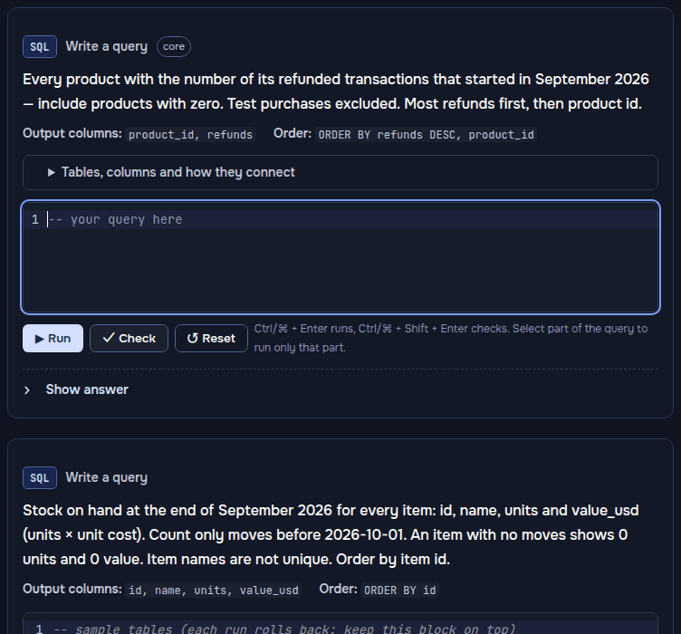
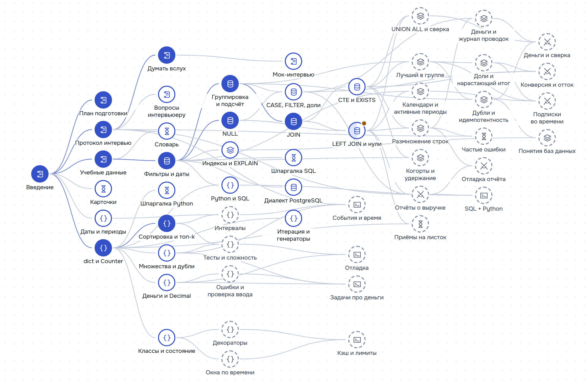

# Карта лайвкодинга

[English](README.md) · **Русский**

Карта лайвкодинга готовит инженеров данных, аналитиков и бэкенд-инженеров к лайвкодингу по SQL
и практическому Python, а русскоязычных инженеров — к интервью на английском: условия задач,
вопросы интервьюеру и фразы для рассуждений вслух — по-английски, объяснения — на русском, так
что к интервью на русском сайт тоже готовит. От сборников SQL-вопросов его отличают четыре
вещи. **Задачи как на интервью на одном реалистичном бизнес-наборе данных**, включая Python как
на работе (идемпотентность, деньги, повторные попытки, отладка сломанного кода), — их проверяют
настоящие тесты прямо в браузере. **Протокол на сам час интервью**: вопросы, которые стоит
задать, с ответами интервьюера, таймер, фразы для рассуждений вслух и вопрос-продолжение.
**Проверки, которые ловят ловушки**: SQL дополнительно запускается на скрытых данных с
граничными случаями. И всё это **бесплатно, без регистрации, с открытым кодом, на русском и
английском**.

### [Открыть сайт](https://butyavk.github.io/live-coding/ru/) · [Карта навыков](https://butyavk.github.io/live-coding/ru/start/skill-map/) · [Мок-интервью](https://butyavk.github.io/live-coding/ru/start/mock-interview/)



<picture>
  <source media="(prefers-color-scheme: dark)" srcset=".github/readme/skill-map-ru-dark.png">
  
</picture>

## Что внутри

- **57 страниц**: семь разделов («С чего начать», основа SQL, приёмы SQL, Python для
  лайвкодинга, задачи SQL, задачи Python и справочник) и две страницы «О проекте».
- **Упражнения на каждой странице темы**: 36 упражнений по SQL, 26 по Python и 23 ловушки —
  короткие запросы, которые выглядят верно, но работают не так: угадать результат,
  запустить, исправить.
- **31 задача как на интервью**, 15 по SQL и 16 по Python: целевое время, вопросы, которые
  стоит задать до кода, таймер, проверка по эталону и разбор с вопросом-продолжением, который
  обычно звучит следом. Три из них — задачи на отладку: рабочий код с ошибками и сообщение об
  ошибке.
- **Мок-интервью**: случайная задача по SQL или Python из вашего плана подготовки, часы уже
  идут (25 минут, у самых длинных задач — больше), и ничто на странице не называет приём.
  Сначала вы сами пишете свои вопросы; подсказка откроется через пять минут, разбор и решение —
  когда пройдёт проверка или выйдет время. В конце — чек-лист для разбора.
- **Скрытые данные с граничными случаями** для ответов на SQL: день без активности, тихий
  месяц, продажи в последний день месяца и ровно в полночь 1-го числа, равные значения, копии
  вебхуков, выплата, которой никто не ждал. Если проверка задачи не прошла, она говорит, где
  результат расходится, но не что написать.
- **Среды выполнения в браузере.** SQL работает на PostgreSQL, скомпилированном в WebAssembly
  ([PGlite](https://pglite.dev/)), Python — на CPython в WebAssembly
  ([Pyodide](https://pyodide.org/)). Оба загружаются с этого же сайта: при первом запуске около
  19 МБ для PostgreSQL и 13 МБ для Python, дальше браузер берёт их из кэша.
- **Учебные данные**: выдуманный маркетплейс подписок. Продавцы продают покупателям продукты по
  подписке через два маркетплейса-партнёра, оплату на сайте и промо-доступ; маркетплейсы платят
  раз в месяц с задержкой, а программа авансов платит продавцам заранее
  ([схема](exercises/SCHEMA.md), на английском).
- **Протокол интервью** на одну задачу (25 минут; самым длинным задачам — их целевое время
  плюс 10): пересказ, вопросы, план, код маленькими шагами, проверка до «готово» — и фразы,
  которыми всё это сказать по-английски.
- **Карта навыков и планы подготовки** на одну неделю, две-три недели или четыре-шесть недель.
  Прогресс хранится только в вашем браузере; **«Скачать прогресс»** сохраняет его в файл, а
  **«Загрузить прогресс»** переносит на другое устройство.
- **Карточки** с интервальными повторениями прямо на сайте и колоды Anki на русском и
  английском из тех же карточек.

## Как учиться

1. **Выберите план** под время, которое у вас есть.
   [План подготовки](https://butyavk.github.io/live-coding/ru/start/study-plan/) превращает
   сайт в чек-лист:

   | План | Срок | Что входит |
   |---|---|---|
   | Короткий | 1 неделя | Протокол, основные упражнения и восемь полных задач на время |
   | Средний | 2–3 недели | Основа и приёмы, которые отличают «прошёл» от «прошёл уверенно»; большинство задач, вслух |
   | Длинный | 4–6 недель | Все темы и все задачи, каждая задача дважды |

2. **Идите по [карте навыков](https://butyavk.github.io/live-coding/ru/start/skill-map/).**
   Каждая тема стоит правее тех, на которые опирается. Карта показывает, что вы уже изучили,
   что можно начинать, что пропустили и что делать дальше.
3. **Решайте упражнения на странице, прежде чем открыть ответ**, и угадывайте результат каждой
   ловушки до запуска. В конце страницы отметьте тему изученной.
4. **Решайте задачи как на интервью вслух и на время**, с пустого окна, по
   [протоколу](https://butyavk.github.io/live-coding/ru/start/interview-protocol/). Разбор
   открывайте только после зелёной проверки.
5. **Перед интервью проведите [мок-интервью](https://butyavk.github.io/live-coding/ru/start/mock-interview/)**
   и разберите его по чек-листу.

| Этап | Разделы | После него вы |
|---|---|---|
| 1. Сориентироваться | [С чего начать](https://butyavk.github.io/live-coding/ru/start/introduction/) | Знаете, что проверяет интервьюер, как распределить время и что лежит в учебных данных |
| 2. Основа SQL | [Основа SQL](https://butyavk.github.io/live-coding/ru/sql/filters-and-dates/) | Фильтруете, группируете и соединяете, не теряя строк, нулей и последнего дня месяца |
| 3. Приёмы SQL | [Приёмы SQL](https://butyavk.github.io/live-coding/ru/sql-patterns/row-multiplication/) | Узнаёте приём за текстом задачи: лучший в группе, каждый день, два источника, дубли, остаток |
| 4. Python | [Python для лайвкодинга](https://butyavk.github.io/live-coding/ru/python/dicts-and-counting/) | Пишете верную функцию маленькими шагами на стандартной библиотеке и называете её сложность |
| 5. Задачи как на интервью | [Задачи SQL](https://butyavk.github.io/live-coding/ru/sql-tasks/revenue-reports/), [Задачи Python](https://butyavk.github.io/live-coding/ru/python-tasks/events-and-time/) | Решаете задачу вслух и укладываетесь в её время: сначала вопросы, проверка до «готово», ответ на продолжение |
| 6. Перед интервью | [Справочник](https://butyavk.github.io/live-coding/ru/reference/recipes/) | Приёмы помещаются на одном листе, частые ошибки известны, а факты вспоминаются за секунды |

SQL и Python не зависят друг от друга: этапы 2–3 и этап 4 можно проходить параллельно.

## Тренировка без браузера

В папке [`exercises/`](exercises/) лежат учебные данные, все задачи как на интервью в виде
файлов, проверки на pytest и эталонные решения. SQL выполняется в DuckDB с синтаксисом
PostgreSQL, Python — вашим интерпретатором:

```bash
cd exercises
pip install -r requirements.txt
python db.py tasks/sql/q01.sql    # выполнить запросы из файла задачи
python db.py                      # интерактивная консоль SQL
pytest -k q01                     # проверить свой ответ
SOLUTIONS=1 pytest                # проверить эталонные решения
```

Подробности — в [exercises/README.md](exercises/README.md) (на английском).

## Как помочь проекту

Нашли неверный ответ, непонятную задачу или опечатку? Создайте
[issue](https://github.com/butyavk/live-coding/issues). Как запустить сайт локально, поправить
страницу или добавить упражнение, описано в [CONTRIBUTING.md](CONTRIBUTING.md) (на английском).

Сайт написан с помощью ИИ-ассистента; каждое упражнение, каждый запрос и каждое число
проверяются автоматическими тестами.

## Лицензия

Код распространяется по [лицензии MIT](LICENSE). Материалы (страницы, упражнения и их
эталонные решения, карточки и учебные данные) — по
[CC BY 4.0](https://creativecommons.org/licenses/by/4.0/deed.ru). PGlite (Apache 2.0), Pyodide
(MPL 2.0), CodeMirror (MIT), Astro и Starlight (MIT) распространяются по своим лицензиям.

Соседний проект — про интервью по системному дизайну:
[Карта системного дизайна](https://butyavk.github.io/system-design/ru/).
